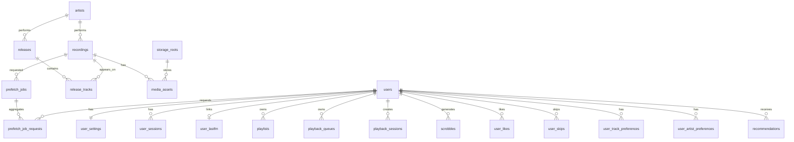

# Data Model

**Проект:** Persephone Music
**Статус:** концептуальная модель; SQL-миграции появятся в [#4](https://github.com/DrRocksoDevelopment/persephone/issues/4)
**Связанные документы:** [ARCHITECTURE.md](../ARCHITECTURE.md), [ADR 0003](adr/0003-postgresql-as-source-of-truth.md), [ADR 0005](adr/0005-multi-storage-abstraction.md)

---

## 1. Принципы

1. PostgreSQL — источник истины для собственных сущностей Persephone.
2. Внутренние идентификаторы — UUID, независимые от MusicBrainz и других сервисов.
3. Внешние идентификаторы (MBID) — nullable-поля с уникальными ограничениями, не первичные ключи.
4. Запись (recording), релиз (release) и физический файл (media asset) — разные сущности.
5. Общие данные библиотеки отделены от пользовательских данных.
6. Пользовательские данные изолированы по `user_id` и проверяются на уровне приложения.
7. Все изменения схемы — только миграциями.

## 2. Соглашения

- Типы: `uuid`, `text`, `citext`, `timestamptz`, `bigint`, `integer`, `smallint`, `numeric`, `jsonb`, `bytea`, `inet`.
- Внутренние PK: `uuid DEFAULT gen_random_uuid()` (расширение `pgcrypto`).
- Время: `timestamptz`, значения в UTC.
- `created_at NOT NULL DEFAULT now()`, `updated_at NOT NULL DEFAULT now()` с триггером обновления.
- Перечисления в MVP — `text` + `CHECK`, а не PostgreSQL `ENUM` (проще мигрировать).
- Имена таблиц — множественное число, `snake_case`.
- Уникальные ограничения и индексы именуются явно.
- Nullable-поля означают «неизвестно», а не «ноль»; для числовых значений использовать `NULL`, не `0`.

## 3. Обзор связей

## 4. Каталог таблиц

### 4.1. Пользователи и доступ

#### `users`

| Колонка | Тип | Ограничения |
|---|---|---|
| `id` | uuid | PK, `gen_random_uuid()` |
| `email` | citext | NOT NULL, UNIQUE |
| `username` | varchar(64) | UNIQUE, NULL допустим |
| `password_hash` | text | NOT NULL, Argon2id |
| `role` | text | NOT NULL, DEFAULT `'user'`, CHECK (`admin`, `user`) |
| `status` | text | NOT NULL, DEFAULT `'active'`, CHECK (`active`, `disabled`) |
| `last_login_at` | timestamptz | NULL |
| `created_at` | timestamptz | NOT NULL |
| `updated_at` | timestamptz | NOT NULL |

#### `user_settings`

| Колонка | Тип | Ограничения |
|---|---|---|
| `user_id` | uuid | PK, FK → `users(id)` |
| `preferred_format` | text | NULL = без предпочтения |
| `max_bitrate_kbps` | integer | NULL или > 0 |
| `transcode_policy` | text | NOT NULL, DEFAULT `'source'`, CHECK (`source`) в MVP |
| `settings` | jsonb | NOT NULL, DEFAULT `'{}'` |
| `updated_at` | timestamptz | NOT NULL |

`transcode_policy` заранее предусматривает будущие режимы (`auto`, `custom`, `always`), но в MVP допускается только `source`. Расширение CHECK — отдельной миграцией вместе с реальной реализацией.

#### `user_sessions`

| Колонка | Тип | Ограничения |
|---|---|---|
| `id` | uuid | PK |
| `user_id` | uuid | NOT NULL, FK → `users(id)` ON DELETE CASCADE |
| `token_hash` | text | NOT NULL, UNIQUE |
| `user_agent` | text | NULL |
| `ip` | inet | NULL |
| `created_at` | timestamptz | NOT NULL |
| `expires_at` | timestamptz | NOT NULL |
| `last_used_at` | timestamptz | NULL |
| `revoked_at` | timestamptz | NULL |

Индексы: `(user_id)`, `(expires_at)`.

### 4.2. Хранилища и каталог

#### `storage_roots`

| Колонка | Тип | Ограничения |
|---|---|---|
| `id` | uuid | PK |
| `name` | text | NOT NULL, UNIQUE |
| `type` | text | NOT NULL, CHECK (`local`, `nfs`, `smb`, `other`) |
| `identifier` | text | NOT NULL — логический mount point/URI |
| `status` | text | NOT NULL, DEFAULT `'active'`, CHECK (`active`, `maintenance`, `disabled`) |
| `created_at` | timestamptz | NOT NULL |
| `updated_at` | timestamptz | NOT NULL |

`identifier` — не абсолютный путь хоста в бизнес-логике, а конфигурационный идентификатор хранилища. Соответствие «storage root → путь в контейнере» задаётся окружением.

#### `artists`

| Колонка | Тип | Ограничения |
|---|---|---|
| `id` | uuid | PK |
| `name` | text | NOT NULL |
| `sort_name` | text | NULL |
| `musicbrainz_artist_id` | uuid | UNIQUE, NULL |
| `created_at` | timestamptz | NOT NULL |
| `updated_at` | timestamptz | NOT NULL |

Индексы: `lower(name)`, `musicbrainz_artist_id`.

#### `releases`

| Колонка | Тип | Ограничения |
|---|---|---|
| `id` | uuid | PK |
| `artist_id` | uuid | NOT NULL, FK → `artists(id)` ON DELETE RESTRICT |
| `title` | text | NOT NULL |
| `release_type` | text | NOT NULL, CHECK (`album`, `single`, `ep`, `compilation`, `live`, `other`) |
| `release_date` | date | NULL |
| `musicbrainz_release_id` | uuid | UNIQUE, NULL |
| `musicbrainz_release_group_id` | uuid | NULL, индекс |
| `created_at` | timestamptz | NOT NULL |
| `updated_at` | timestamptz | NOT NULL |

#### `recordings`

| Колонка | Тип | Ограничения |
|---|---|---|
| `id` | uuid | PK |
| `artist_id` | uuid | NOT NULL, FK → `artists(id)` ON DELETE RESTRICT |
| `title` | text | NOT NULL |
| `duration_ms` | integer | NULL или >= 0 |
| `musicbrainz_recording_id` | uuid | UNIQUE, NULL |
| `created_at` | timestamptz | NOT NULL |
| `updated_at` | timestamptz | NOT NULL |

MVP использует одного основного исполнителя на запись. Поддержка нескольких исполнителей — отдельная задача (см. открытые вопросы).

#### `release_tracks`

| Колонка | Тип | Ограничения |
|---|---|---|
| `id` | uuid | PK |
| `release_id` | uuid | NOT NULL, FK → `releases(id)` ON DELETE CASCADE |
| `recording_id` | uuid | NOT NULL, FK → `recordings(id)` ON DELETE RESTRICT |
| `disc_number` | smallint | NOT NULL, DEFAULT 1, > 0 |
| `track_number` | smallint | NOT NULL, > 0 |
| `title_override` | text | NULL — название позиции на релизе |
| `duration_ms` | integer | NULL |

Ограничения: UNIQUE `(release_id, disc_number, track_number)`; индекс `(recording_id)`.
Одна запись может входить в несколько релизов.

#### `media_assets`

| Колонка | Тип | Ограничения |
|---|---|---|
| `id` | uuid | PK |
| `recording_id` | uuid | NOT NULL, FK → `recordings(id)` ON DELETE RESTRICT |
| `storage_root_id` | uuid | NOT NULL, FK → `storage_roots(id)` ON DELETE RESTRICT |
| `relative_path` | text | NOT NULL |
| `format` | varchar(16) | NOT NULL (`flac`, `mp3`, `aac`, …) |
| `size_bytes` | bigint | NOT NULL, > 0 |
| `sha256` | char(64) | NOT NULL, CHECK hex |
| `bitrate_kbps` | integer | NULL |
| `sample_rate_hz` | integer | NULL |
| `channels` | smallint | NULL |
| `duration_ms` | integer | NULL |
| `status` | text | NOT NULL, DEFAULT `'available'`, CHECK (`available`, `missing`, `quarantined`) |
| `created_at` | timestamptz | NOT NULL |
| `updated_at` | timestamptz | NOT NULL |

Ограничения:

- UNIQUE `(storage_root_id, relative_path)` — путь уникален в пределах хранилища.
- INDEX `(sha256, size_bytes)` — поиск дубликатов и дедупликация.
- INDEX `(recording_id)`.
- Один recording может иметь несколько media_assets (FLAC + MP3, разные хранилища).

### 4.3. Интеграции

#### `user_lastfm`

| Колонка | Тип | Ограничения |
|---|---|---|
| `user_id` | uuid | PK, FK → `users(id)` ON DELETE CASCADE |
| `lastfm_username` | text | NOT NULL |
| `session_key_encrypted` | bytea | NOT NULL |
| `encryption_key_version` | smallint | NOT NULL, DEFAULT 1 |
| `status` | text | NOT NULL, CHECK (`connected`, `error`, `disconnected`) |
| `last_synced_at` | timestamptz | NULL |
| `created_at` | timestamptz | NOT NULL |
| `updated_at` | timestamptz | NOT NULL |

Session key никогда не хранится в открытом виде и не логируется. Индекс `(lastfm_username)`.

#### `external_recommendation_cache`

| Колонка | Тип | Ограничения |
|---|---|---|
| `id` | uuid | PK |
| `source` | text | NOT NULL (`lastfm`, `musicbrainz`) |
| `entity_type` | text | NOT NULL (`artist`, `recording`, `release`) |
| `external_id` | text | NOT NULL |
| `payload` | jsonb | NOT NULL |
| `fetched_at` | timestamptz | NOT NULL |
| `expires_at` | timestamptz | NOT NULL |

UNIQUE `(source, entity_type, external_id)`; индекс `(expires_at)`.

### 4.4. История и предпочтения

#### `playback_sessions`

| Колонка | Тип | Ограничения |
|---|---|---|
| `id` | uuid | PK |
| `user_id` | uuid | NOT NULL, FK → `users(id)` ON DELETE CASCADE |
| `recording_id` | uuid | NOT NULL, FK → `recordings(id)` ON DELETE RESTRICT |
| `media_asset_id` | uuid | NULL, FK → `media_assets(id)` ON DELETE SET NULL |
| `started_at` | timestamptz | NOT NULL |
| `ended_at` | timestamptz | NULL |
| `start_position_ms` | integer | NOT NULL, DEFAULT 0 |
| `end_position_ms` | integer | NULL |
| `listened_ms` | integer | NULL |
| `completed` | boolean | NOT NULL, DEFAULT false |
| `source` | text | NOT NULL, CHECK (`web`, `subsonic`, `api`) |
| `created_at` | timestamptz | NOT NULL |

Индексы: `(user_id, started_at DESC)`, `(recording_id)`.

#### `scrobbles`

| Колонка | Тип | Ограничения |
|---|---|---|
| `id` | uuid | PK |
| `user_id` | uuid | NOT NULL, FK → `users(id)` ON DELETE CASCADE |
| `recording_id` | uuid | NOT NULL, FK → `recordings(id)` ON DELETE RESTRICT |
| `playback_session_id` | uuid | NULL, FK → `playback_sessions(id)` ON DELETE SET NULL |
| `played_at` | timestamptz | NOT NULL |
| `status` | text | NOT NULL, DEFAULT `'pending'`, CHECK (`pending`, `sent`, `failed`, `skipped`) |
| `attempt_count` | integer | NOT NULL, DEFAULT 0 |
| `last_attempt_at` | timestamptz | NULL |
| `last_error` | text | NULL |
| `created_at` | timestamptz | NOT NULL |

UNIQUE `(user_id, recording_id, played_at)` — защита от дублирования.
Индекс `(status, last_attempt_at)` для очереди повторных отправок.

#### `user_track_preferences`

| Колонка | Тип | Ограничения |
|---|---|---|
| `user_id` | uuid | PK, FK → `users(id)` ON DELETE CASCADE |
| `recording_id` | uuid | PK, FK → `recordings(id)` ON DELETE CASCADE |
| `affinity_score` | numeric(6,3) | NOT NULL, DEFAULT 0 |
| `play_count` | integer | NOT NULL, DEFAULT 0 |
| `skip_count` | integer | NOT NULL, DEFAULT 0 |
| `last_played_at` | timestamptz | NULL |
| `last_skipped_at` | timestamptz | NULL |
| `updated_at` | timestamptz | NOT NULL |

Индекс `(user_id, affinity_score DESC)`.

#### `user_artist_preferences`

| Колонка | Тип | Ограничения |
|---|---|---|
| `user_id` | uuid | PK, FK → `users(id)` ON DELETE CASCADE |
| `artist_id` | uuid | PK, FK → `artists(id)` ON DELETE CASCADE |
| `affinity_score` | numeric(6,3) | NOT NULL, DEFAULT 0 |
| `play_count` | integer | NOT NULL, DEFAULT 0 |
| `skip_count` | integer | NOT NULL, DEFAULT 0 |
| `updated_at` | timestamptz | NOT NULL |

Индекс `(user_id, affinity_score DESC)`.

#### `user_likes`

| Колонка | Тип | Ограничения |
|---|---|---|
| `user_id` | uuid | PK, FK → `users(id)` ON DELETE CASCADE |
| `recording_id` | uuid | PK, FK → `recordings(id)` ON DELETE CASCADE |
| `created_at` | timestamptz | NOT NULL |

Индекс `(recording_id)`.

#### `user_skips`

| Колонка | Тип | Ограничения |
|---|---|---|
| `id` | uuid | PK |
| `user_id` | uuid | NOT NULL, FK → `users(id)` ON DELETE CASCADE |
| `recording_id` | uuid | NOT NULL, FK → `recordings(id)` ON DELETE CASCADE |
| `playback_session_id` | uuid | NULL, FK → `playback_sessions(id)` ON DELETE SET NULL |
| `skipped_at` | timestamptz | NOT NULL |
| `position_ms` | integer | NULL |

Индекс `(user_id, skipped_at DESC)`.

### 4.5. Плейлисты и очередь

#### `playlists`

| Колонка | Тип | Ограничения |
|---|---|---|
| `id` | uuid | PK |
| `user_id` | uuid | NOT NULL, FK → `users(id)` ON DELETE CASCADE |
| `name` | varchar(255) | NOT NULL |
| `description` | text | NULL |
| `is_public` | boolean | NOT NULL, DEFAULT false |
| `created_at` | timestamptz | NOT NULL |
| `updated_at` | timestamptz | NOT NULL |

UNIQUE `(user_id, name)`; индекс `(user_id)`.

#### `playlist_tracks`

| Колонка | Тип | Ограничения |
|---|---|---|
| `id` | uuid | PK |
| `playlist_id` | uuid | NOT NULL, FK → `playlists(id)` ON DELETE CASCADE |
| `recording_id` | uuid | NOT NULL, FK → `recordings(id)` ON DELETE RESTRICT |
| `position` | integer | NOT NULL, >= 0 |
| `added_at` | timestamptz | NOT NULL |

UNIQUE `(playlist_id, position) DEFERRABLE INITIALLY IMMEDIATE` — позволяет переупорядочивание в одной транзакции.
Индекс `(recording_id)`.

#### `playback_queues`

| Колонка | Тип | Ограничения |
|---|---|---|
| `id` | uuid | PK |
| `user_id` | uuid | NOT NULL, FK → `users(id)` ON DELETE CASCADE |
| `name` | varchar(64) | NOT NULL, DEFAULT `'default'` |
| `created_at` | timestamptz | NOT NULL |
| `updated_at` | timestamptz | NOT NULL |

UNIQUE `(user_id, name)`.

#### `playback_queue_items`

| Колонка | Тип | Ограничения |
|---|---|---|
| `id` | uuid | PK |
| `queue_id` | uuid | NOT NULL, FK → `playback_queues(id)` ON DELETE CASCADE |
| `recording_id` | uuid | NOT NULL, FK → `recordings(id)` ON DELETE RESTRICT |
| `position` | integer | NOT NULL, >= 0 |
| `added_at` | timestamptz | NOT NULL |

UNIQUE `(queue_id, position) DEFERRABLE INITIALLY IMMEDIATE`.

### 4.6. Рекомендации

#### `recommendations`

| Колонка | Тип | Ограничения |
|---|---|---|
| `id` | uuid | PK |
| `user_id` | uuid | NOT NULL, FK → `users(id)` ON DELETE CASCADE |
| `recording_id` | uuid | NOT NULL, FK → `recordings(id)` ON DELETE CASCADE |
| `batch_id` | uuid | NOT NULL — идентификатор генерации |
| `score` | numeric(8,5) | NOT NULL |
| `reason_code` | text | NOT NULL, CHECK (`similar_artist`, `favorite_artist`, `recent_album`, `lastfm`, `genre`, `rediscover`, `radio`) |
| `reason_text` | text | NULL — человекочитаемое объяснение |
| `source` | text | NULL — источник кандидата |
| `status` | text | NOT NULL, DEFAULT `'active'`, CHECK (`active`, `dismissed`, `played`, `expired`) |
| `generated_at` | timestamptz | NOT NULL |
| `expires_at` | timestamptz | NULL |

UNIQUE `(user_id, recording_id, batch_id)`; индекс `(user_id, status, score DESC)`, `(expires_at)`.

### 4.7. Prefetch

#### `prefetch_jobs`

| Колонка | Тип | Ограничения |
|---|---|---|
| `id` | uuid | PK |
| `recording_id` | uuid | NOT NULL, FK → `recordings(id)` ON DELETE RESTRICT |
| `status` | text | NOT NULL, DEFAULT `'pending'`, CHECK (`pending`, `queued`, `running`, `completed`, `failed`, `cancelled`) |
| `priority` | integer | NOT NULL, DEFAULT 0 |
| `attempt_count` | integer | NOT NULL, DEFAULT 0 |
| `max_attempts` | integer | NOT NULL, DEFAULT 5 |
| `last_error` | text | NULL |
| `created_at` | timestamptz | NOT NULL |
| `updated_at` | timestamptz | NOT NULL |
| `completed_at` | timestamptz | NULL |

Частичный UNIQUE-индекс `(recording_id) WHERE status IN ('pending', 'queued', 'running')` — одна активная задача на запись.
Индекс `(status, priority DESC, created_at)`.

#### `prefetch_job_requests`

| Колонка | Тип | Ограничения |
|---|---|---|
| `id` | uuid | PK |
| `job_id` | uuid | NOT NULL, FK → `prefetch_jobs(id)` ON DELETE CASCADE |
| `user_id` | uuid | NOT NULL, FK → `users(id)` ON DELETE CASCADE |
| `reason` | text | NOT NULL, CHECK (`radio`, `playlist`, `recommendation`, `manual`) |
| `priority` | integer | NOT NULL, DEFAULT 0 |
| `created_at` | timestamptz | NOT NULL |

UNIQUE `(job_id, user_id, reason)` — один пользовательский запрос на задачу.

## 5. Инварианты

1. `recordings` не содержит абсолютных путей и не зависит от наличия файла.
2. Одна запись может быть на нескольких релизах; позиция релиза не создаёт новую запись.
3. `media_assets.relative_path` уникален внутри `storage_root`.
4. Один `media_asset` принадлежит одной записи; одна запись может иметь несколько файлов.
5. Все пользовательские строки содержат `user_id`, кроме справочников.
6. Пользователь не может читать или изменять данные другого пользователя.
7. Активная prefetch-задача для одной записи — не более одной.
8. Скроббл уникален по `(user_id, recording_id, played_at)`.
9. `transcode_policy` в MVP — только `source`.
10. Внутренние ID не переиспользуются и не заменяются внешними.

## 6. Политика удаления

| Сущность | Поведение |
|---|---|
| Пользователь | `status = 'disabled'`; физическая очистка — отдельная административная процедура с подтверждением |
| Сессии пользователя | CASCADE при удалении пользователя |
| Пользовательские данные | CASCADE только при явной очистке пользователя |
| Артист, запись, релиз | RESTRICT при наличии ссылок; объединение дубликатов — отдельная операция |
| Медиафайл | При потере файла — `status = 'missing'`, не удаление строки |
| Плейлист | CASCADE для позиций плейлиста |
| Prefetch-задача | Отмена через `status = 'cancelled'`; удаление — только после истечения срока хранения |

Запрещено каскадно удалять каталог или историю при удалении одного пользовательского ресурса.

## 7. План индексов

- Все внешние ключи — индексируются.
- Пользовательские выборки: `(user_id, <time|score> DESC)`.
- Очередь скробблов: `(status, last_attempt_at)`.
- Поиск каталога: `lower(name)` для артистов; trigram-индексы появятся вместе с поиском (Stage 1).
- `media_assets`: `(sha256, size_bytes)`, `(storage_root_id, relative_path)`.
- Частичные индексы для активных prefetch-задач и pending-скробблов.

Индексы добавляются по измеряемым запросам, а не «на всякий случай».

## 8. Миграции

- Каталог: `app/src/db/migrations/`.
- Имя: `NNNN_short_description.sql` (например, `0001_initial_schema.sql`).
- Одна миграция — одна логическая группа изменений.
- Каждая миграция применяется в транзакции.
- Миграции forward-only; откат — компенсирующей миграцией ([ADR 0006](adr/0006-forward-only-migrations.md)).
- Таблица учёта: `schema_migrations (version, name, applied_at, checksum)`.
- Изменение схемы без миграции запрещено.
- Разрушительные изменения (удаление колонок/таблиц) — только через Issue и с планом переноса данных.
- Проверка: миграции применяются на пустой базе в CI.

## 9. Открытые вопросы

1. Несколько исполнителей на запись — нужна таблица кредитов.
2. Уникальность `lastfm_username` между пользователями.
3. Политика хранения истории прослушиваний и скробблов (срок, архивирование).
4. Стратегия версионирования ключа шифрования Last.fm.
5. Партиционирование `playback_sessions`/`scrobbles` при росте объёма.
6. Точная схема хранения оценок (пятизвёздочные vs. бинарные лайки) — после Stage 4.
